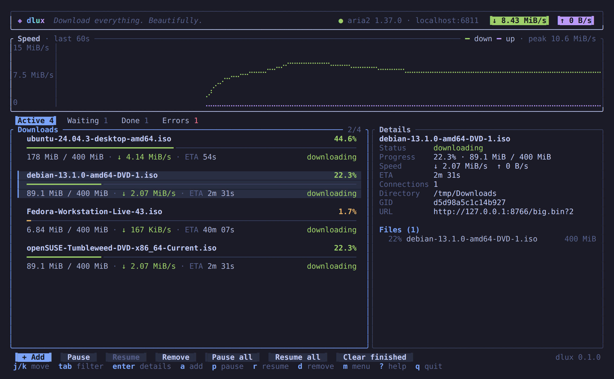
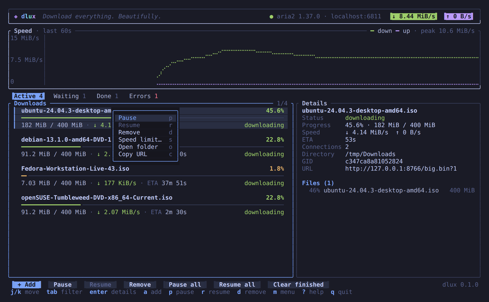
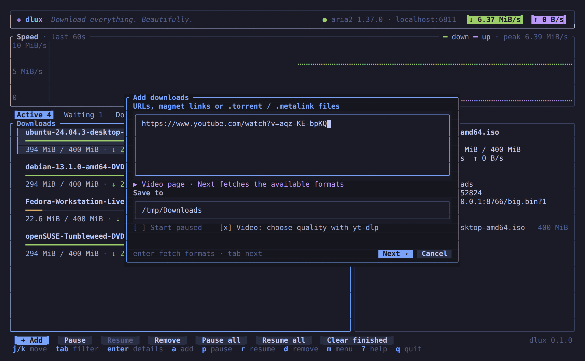
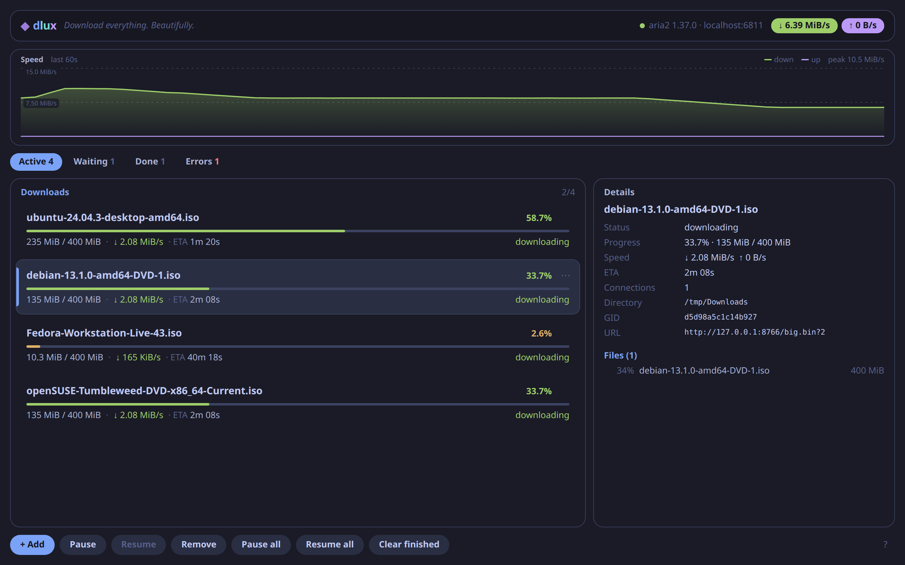
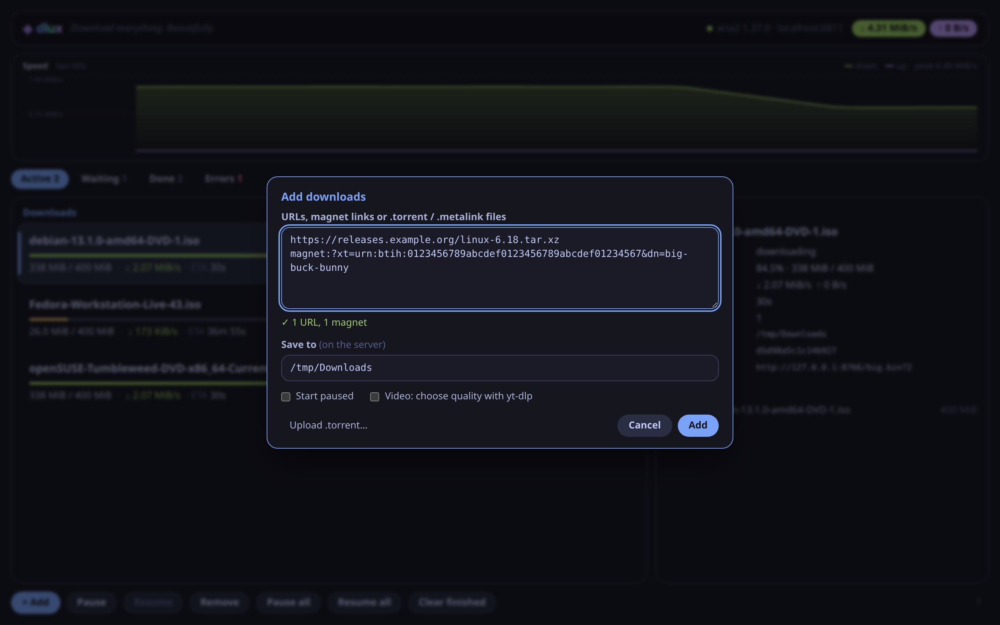
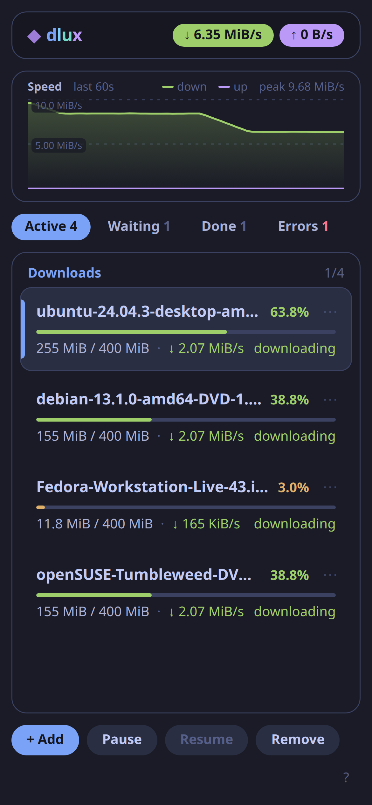

# dlux

**Download everything. Beautifully.**

dlux is a modern download manager built on [aria2](https://aria2.github.io/). It has a terminal UI
you can drive entirely with the mouse (or the keyboard), and a web UI for your browser or phone —
both showing the same live downloads.

- HTTP(S), FTP, SFTP, BitTorrent, magnet links and Metalink, through aria2
- Video sites through [yt-dlp](https://github.com/yt-dlp/yt-dlp), with a quality picker
- Live speed graph, per-download and global speed limits, pause/resume/remove, pause all
- One self-contained binary: the web UI is built in, and dlux starts aria2 for you if needed



| | |
|---|---|
|  |  |
|  |  |

<p align="center"></p>

## Install

dlux needs **aria2** (`aria2c`): `sudo apt install aria2`, `brew install aria2`,
`winget install aria2.aria2`. yt-dlp and ffmpeg are optional — if they aren't installed, dlux
downloads them the first time you add a video.

**Prebuilt** — from the [latest release](https://github.com/SaraVix1/DLuxDownloadManager/releases/latest):

| System | Download |
|--------|----------|
| Debian / Ubuntu (x86_64, arm64) | `dlux_*_amd64.deb` / `dlux_*_arm64.deb` → `sudo apt install ./dlux_*.deb` (pulls in aria2) |
| Other Linux (x86_64, aarch64, glibc 2.35+) | `dlux-*-x86_64-unknown-linux-gnu.tar.gz` / `…-aarch64-…` — put `dlux` on your `PATH` |
| Windows (x86_64) | `dlux-*-x86_64-pc-windows-msvc.zip` |

Check downloads against `SHA256SUMS` in the release.

**With Cargo** (Rust 1.88+): `cargo install dlux`

**From source:**

```sh
git clone https://github.com/SaraVix1/DLuxDownloadManager && cd DLuxDownloadManager
npm --prefix web ci && npm --prefix web run build    # the web UI (needs Node.js 22+)
cargo install --path crates/dlux
```

## Use it

```sh
dlux                 # the terminal UI
dlux serve           # the web UI on http://127.0.0.1:8080
dlux status          # aria2 version, speeds and downloads (add --json for scripts)
dlux config init     # write ~/.config/dlux/config.toml with the defaults
```

dlux connects to the aria2 at `http://localhost:6800/jsonrpc`. If none is running, it starts a
private `aria2c` (with a random RPC secret) and stops it again when you quit. To use an aria2 you
already run, set `rpc_url` and `rpc_secret` in the config, or pass `--rpc-url` / `--rpc-secret`.

**Adding downloads:** press `a` or click **+ Add**, or just paste. Put one URL, magnet link or
`.torrent` / `.metalink` path per line. In the web UI you can also drop files or links anywhere on
the page.

**Videos:** paste a link to a video page (YouTube, Vimeo, and [everything else yt-dlp
supports](https://github.com/yt-dlp/yt-dlp/blob/master/supportedsites.md)). dlux switches to video
mode, asks yt-dlp which qualities exist, and lets you pick one — "1080p60 · mp4 · ~571 MiB",
"Audio only", … Downloads go through aria2c and show up as cards tagged *video*. Press `U` (or
**Update yt-dlp** in the picker) when a site stops working.

### Keyboard

The same keys work in the terminal and the web UI.

| Key | Action |
|-----|--------|
| `j` `k` / `↓` `↑` | Move the selection (`g` `G` / `Home` `End`: first, last) |
| `1`–`4` | Switch tab: Active, Waiting, Done, Errors (`Tab` too, in the terminal UI) |
| `Enter` | Show / hide details |
| `a` | Add downloads (pasting works too) |
| `p` `r` `Space` | Pause, resume, toggle |
| `P` `R` | Pause all, resume all |
| `d` `Delete` | Remove (asks first if it isn't finished; files stay on disk) |
| `X` | Clear finished downloads from the list |
| `s` `S` | Speed limit for the download / for everything |
| `o` | Open the download's folder (terminal UI) |
| `c` | Copy the URL |
| `m` | Actions menu (terminal UI) |
| `U` | Update yt-dlp |
| `?` | Help |
| `q` `Esc` | Quit the terminal UI (`Esc` closes dialogs and menus first) |

In dialogs: `Tab` moves between fields, `Enter` confirms, `Esc` cancels. In the terminal Add
dialog, `Alt+Enter` starts a new line; in the web one, `Shift+Enter`.

### Mouse and touch

| Do this | To |
|---------|----|
| Click a card, tab, button or key hint | Select it / run it |
| Double-click a card | Open its details |
| Right-click a card (or tap `⋯` on a phone) | Pause, resume, remove, speed limit, open folder, copy URL |
| Scroll the wheel | Scroll the list (over the tabs: switch tabs) |
| Drag the scrollbar | Scroll (terminal UI) |
| Click the ↓ / ↑ speeds | Set the global speed limit |
| Drop files or links on the page | Add them (web UI) |

The terminal UI needs a terminal with mouse support — practically all of them (kitty, WezTerm,
Alacritty, GNOME Terminal, Konsole, Windows Terminal, iTerm2, tmux…). True colour is used when the
terminal announces it, with a 256-colour fallback.

## The web UI

`dlux serve` listens on `127.0.0.1:8080` (`--port`, `--bind` to change it). It shows the same live
list as the terminal UI, works on phones, and can be installed as an app from the browser menu.

To reach it from other devices, set a token and bind to your network:

```toml
# ~/.config/dlux/config.toml
[web]
token = "a long random string"
```

```sh
dlux serve --bind 0.0.0.0
```

Then open `http://<your-computer>:8080/` and sign in with the token. dlux refuses to listen on
anything but localhost without one. Anyone with the token can add downloads, so treat it like a
password, and put HTTPS in front (e.g. a reverse proxy) if it's reachable beyond your home network.
The aria2 RPC secret never reaches the browser. More in [SECURITY.md](SECURITY.md).

The API the web UI uses is documented at the top of
[`crates/dlux/src/web/mod.rs`](crates/dlux/src/web/mod.rs) — handy for scripts.

### Run it in the background (systemd)

The `.deb` installs a user service:

```sh
systemctl --user enable --now dlux     # start now and at login
loginctl enable-linger "$USER"         # optional: keep running while logged out
```

With `cargo install`, copy [`packaging/systemd/dlux.service`](packaging/systemd/dlux.service) to
`~/.config/systemd/user/` and change `ExecStart` to `%h/.cargo/bin/dlux serve`.

## Configuration

`~/.config/dlux/config.toml` (on Windows `%APPDATA%\dlux\config.toml`; `dlux config path` prints
it). Everything is optional:

```toml
[aria2]
rpc_url = "http://localhost:6800/jsonrpc"
# rpc_secret = "…"            # the --rpc-secret of an aria2 you run yourself
auto_spawn = true             # start a private aria2c if none is running (local URLs only)
# aria2c_path = "/opt/aria2/bin/aria2c"
extra_args = []               # extra flags for the aria2c dlux starts

[downloads]
dir = "~/Downloads"
max_concurrent = 5

[ui]
theme = "tokyo-night"         # or "tokyo-night-storm"

[web]
# token = "…"                 # required for dlux serve --bind <non-loopback>
```

dlux keeps its data in `~/.local/share/dlux/` (Windows: `%LOCALAPPDATA%\dlux\`): the aria2 session (so downloads survive restarts),
the terminal UI log (`dlux.log`) and the yt-dlp / ffmpeg it installs (`bin/`).

## Troubleshooting

- **"aria2c was not found"** — install aria2, or set `aria2c_path`.
- **A video won't download** — press `U` to update yt-dlp; sites change often. YouTube may need a
  JavaScript runtime ([deno](https://deno.com/)) for some formats.
- **Resuming fails with "Invalid range header"** — the server doesn't support resuming; remove the
  download and add it again.
- **Logs** — the terminal UI writes `~/.local/share/dlux/dlux.log`; run any command with `-vv` for
  more detail.

## Contributing

Issues and pull requests are welcome — see [CONTRIBUTING.md](CONTRIBUTING.md). dlux is written in
Rust (ratatui, tokio, axum) with a Svelte web UI; [CLAUDE.md](CLAUDE.md) describes the design.

## License

[MIT](LICENSE)
